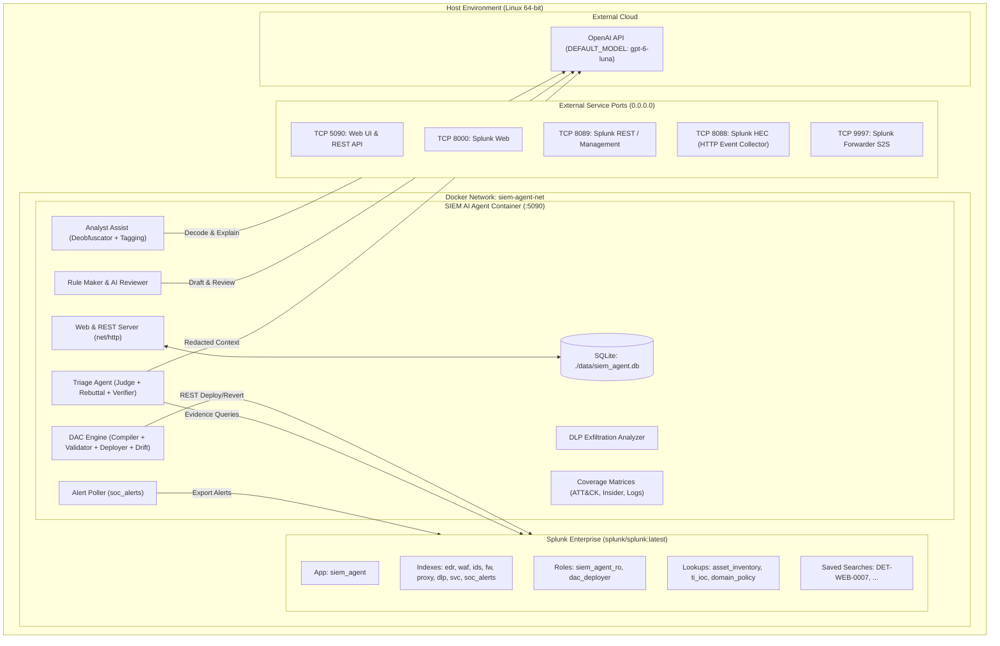

# Logccino — 엔터프라이즈 SIEM AI Agent 플랫폼

Logccino는 Splunk Enterprise 환경에서 **Detection as Code (DAC)** 엔진과 **AI 보안관제 에이전트(Triage & DLP & Analyst Assist)**를 결합하여 보안 운영(SOC)의 탐지 규칙 수명주기와 경보 심층 분석을 완전 자동화하는 엔터프라이즈 보안 솔루션입니다.

Toss GUARDIANS 26의 교훈을 바탕으로 **"AI 품질은 구조에서 나온다"**는 철학 하에 설계되었으며, LLM은 초안 및 가설 수립에만 사용되고 모든 SPL 수집, 스키마 검증, 환각 방지 대조, 배포 및 격리는 **결정론적인 Go 1.24+ 코드**에 의해 통제됩니다.

---

## 🏛️ 시스템 아키텍처 (Architecture)



---

## 🔒 보안 규칙 및 포트 통제 (Security & Compliance)

### 1. 외부 바인딩 포트 목록
모든 서비스 포트는 외부 연동 및 원격 관제를 위해 `0.0.0.0` 인터페이스에 바인딩됩니다:
- `5090`: SIEM AI Agent 웹 콘솔 및 REST API
- `8000`: Splunk Web 콘솔
- `8089`: Splunk 관리 및 REST API (TLS 암호화)
- `8088`: Splunk HEC (HTTP Event Collector, TLS 암호화)
- `9997`: Splunk 포워더 수신 포트

> [!CAUTION]
> 포트가 외부에 공개되므로 호스트 방화벽(`ufw` 또는 `iptables`)을 통해 신뢰할 수 있는 사내 IP/VPN 대역만 접근 가능하도록 반드시 인바운드 규칙을 구성해야 합니다.

### 2. 호스트 방화벽 설정 예시 (`ufw`)
```bash
# 기본 인바운드 차단 및 아웃바운드 허용
sudo ufw default deny incoming
sudo ufw default allow outgoing

# 특정 관리자/SOC 내부망(예: 10.10.0.0/16)에서만 서비스 포트 허용
sudo ufw allow from 10.10.0.0/16 to any port 5090 proto tcp comment "SIEM AI Agent Web"
sudo ufw allow from 10.10.0.0/16 to any port 8000 proto tcp comment "Splunk Web"
sudo ufw allow from 10.10.0.0/16 to any port 8089 proto tcp comment "Splunk Management REST"
sudo ufw allow from 10.10.0.0/16 to any port 8088 proto tcp comment "Splunk HEC"
sudo ufw allow from 10.10.0.0/16 to any port 9997 proto tcp comment "Splunk Forwarder"

sudo ufw enable
```

### 3. 최소 권한 계정 분리
- **`siem_agent_ro`**: 관제 및 트리아지 에이전트 전용 계정. 지정된 8개 인덱스 및 룩업에 대한 읽기/검색 권한만 보유 (`deleteByKeyword = disabled`, 저장 검색 수정 권한 없음).
- **`dac_deployer`**: Detection as Code 배포 전용 계정. 저장 검색(`savedsearch`) 생성, 스케줄링 및 수정 권한만 보유.
- **비밀값 관리**: `.env` 파일은 `.gitignore`에 등록되어 커밋되지 않으며, UI나 로그 출력 시 API 키는 뒤 4자리를 제외하고 전면 마스킹 처리됩니다.

---

## 🛠️ 핵심 컴포넌트 및 기능

### 1. Detection as Code (DAC) 엔진 (`dacctl`)
- **결정론적 컴파일러**: YAML 규칙 파일을 Splunk Saved Search 배포 JSON으로 바이트 단위까지 동일하게 컴파일.
- **3중 유효성 검증기**:
  - `rule.schema.json` JSON Schema 검증.
  - 소스 프로파일(`rules/source_profiles/*.yaml`) 필드 일치성 검증 (오타 및 미존재 필드 즉시 거절).
  - SPL 가드(`splguard`): `delete`, `outputlookup`, 와일드카드 인덱스 차단 및 최대 7일 검색 기간 상한 강제.
- **배포 및 드리프트 관리**:
  - 원자적 배포 및 자동 백업/롤백 지원.
  - Splunk 웹 콘솔 등에서 수동으로 수정된 형상 드리프트(`console_modified`) 자동 감지 및 1-클릭 복원(`dacctl drift revert`).

### 2. Dual-LLM Triage & Anti-Hallucination Verifier
- **증거 우선 원칙 (Evidence-First)**: LLM 판단 전 Splunk 인덱스 및 룩업에서 결정론적 코드로 증거(`E1`, `E2`, ...)를 먼저 수집.
- **판정 및 반박자 (Judge & Rebuttal)**:
  - 1차 Judge가 판정 초안과 근거 인용을 작성.
  - 2차 Rebuttal 에이전트가 "오탐 가능성"을 검증하고 약한 근거를 반박.
- **결정론적 검증기 (Verifier)**:
  - 인용된 증거 ID가 실제 존재하는지 대조 (미존재 `E99` 인용 시 강제 격하).
  - `error` 또는 `empty` 증거에 기반한 부정 명제(예: "추가 로그 없음") 발견 시 판정을 `needs_more_info`로 안전하게 격하.
  - 수집된 증거 본문에 없는 IP/사용자명 등 환각 토큰 검출 시 티켓에 감사 플래그 기록.
- **민감정보 토큰화 마스킹**: IP, 호스트, 사용자명 등 외부 LLM 전송 시 `USER_1`, `HOST_3` 등으로 결정론적 가역 치환 후 응답 시 자동 복원.

### 3. DLP 내부정보 유출 판정 에이전트
- 비즈니스 부서별 데이터 등급 정책(`rules/exceptions/dlp_policy.yaml`) 대조.
- 승인되지 않은 외부 파일 변환/클라우드 사이트 반출 행위에 대한 소명 요청(`request_justification`) 또는 승인된 비즈니스 예외 판정 지원.

### 4. 분석가 보조 (Analyst Assist)
- 다단계 난독화 자동 해제: Base64, UTF-16LE, URL 인코딩, Hex 등 혼합 난독화를 결정론적으로 해제.
- 위험 명령어/토큰(`IEX`, `WebClient`, `DownloadString`, `Bypass` 등) 하이라이트.
- 행동 해석 초안 생성 시 확신도 태그(`[확인]`, `[추정]`, `[미확인]`) 강제 적용.

### 5. 탐지 커버리지 매트릭스 (4종)
- MITRE ATT&CK Matrix (Tactic & Technique 커버리지)
- 내부자 위협 데이터 반출 매트릭스 (Insider Threat Exfiltration Matrix)
- 로그 소스 감시 현황 (Log Monitoring Matrix)
- 레드팀 취약점 제보 연계 및 임시 탐지 규칙 자동 생성

---

## 🚀 빠른 시작 가이드 (Quickstart)

### 요구사항
- Linux 64-bit OS
- Docker & Docker Compose v2+
- Go 1.24+ (컨테이너 내 빌드 제공)
- OpenAI API Key (`OPENAI_API_KEY`)

### 1. 환경 설정
```bash
# 환경 설정 파일 복사 및 API 키 설정
cp .env.example .env
vi .env
# OPENAI_API_KEY=sk-... 및 SPLUNK_PASSWORD 입력
```

### 2. 컨테이너 기동 및 초기화
```bash
# 사전 포트 점유 검사 및 컨테이너 기동
make preflight
make up

# Splunk 계정 및 HEC 토큰 멱등 프로비저닝
./bin/dacctl bootstrap

# LLM 모델 호환성 점검
./bin/dacctl llm-check
```

### 3. 합성 로그 주입 및 소스 프로파일 갱신
```bash
# S1~S8 시나리오 합성 로그 Splunk HEC 주입
./bin/loggen --scenario all --count 200

# Splunk fieldsummary 기반 소스 프로파일 최신화
./bin/dacctl profile refresh
```

### 4. 탐지 규칙 배포 (DAC)
```bash
# 규칙 검증, 컴파일 및 배포
./bin/dacctl validate
./bin/dacctl compile
./bin/dacctl deploy
```

### 5. 전체 검증 및 평가 하네스 실행
```bash
# 빌드, 단위 테스트, 프롬프트 린트 및 Compose 헬스체크
make verify
make test

# 프롬프트 충돌 린트
./bin/eval lint-prompts

# 8종 시나리오 벤치마크 평가 (결정론적 모의 평가 또는 라이브 평가)
./bin/eval --limit 15
```

---

## 🖥️ 웹 콘솔 안내 (`http://localhost:5090`)

- **`/`**: 종합 관제 대시보드 (총 티켓 수, AI/인간 판정 일치율, 배포 현황)
- **`/tickets`**: 실시간 티켓 관제 센터
- **`/tickets/{id}`**: 상세 트리아지 분석 보고서 및 분석가 조치 승인(Human-in-the-Loop)
- **`/rules`**: 탐지 규칙(DAC) 목록 및 세부 형상
- **`/rulemaker`**: 자연어 의도 기반 탐지 규칙 생성 및 AI 리뷰
- **`/changes`**: 변경 요청(CR) 및 배포 승인 워크플로우
- **`/drift`**: Splunk 형상 드리프트 실시간 감지 및 1-클릭 복구
- **`/assist`**: 분석가 난독화 해제 및 AI 행동 해석
- **`/coverage`**: 4종 탐지 커버리지 매트릭스
- **`/redteam`**: 레드팀 취약점 제보 연계 폼
- **`/settings/prompts`**: 버전 관리되는 시스템 프롬프트 현황 조회

---

## 📄 라이선스
본 프로젝트는 보안관제 자동화 및 Detection as Code 표준 연구를 위해 개발되었습니다.
