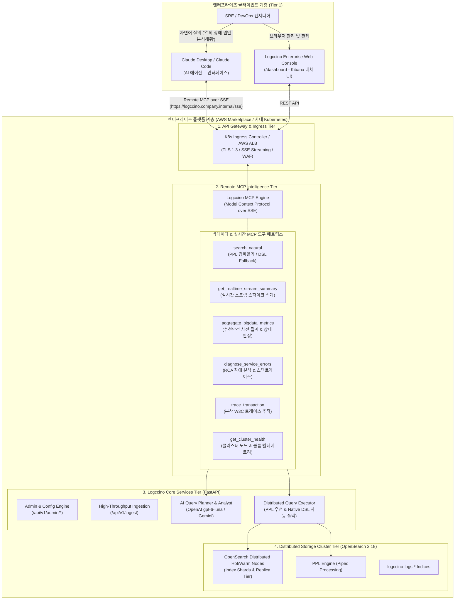

# 🏛️ Logccino Enterprise 시스템 아키텍처 (Enterprise Architecture Overview)

Logccino Enterprise는 로컬 1대의 PC에서 구동되는 Claude, Antigravity 등의 AI 에이전트가 단독으로 처리할 수 없는 **대용량(TB~PB) 분산 데이터 및 초고속 실시간 스트림 데이터를 AWS 마켓플레이스 또는 사내 Kubernetes(k8s) 분산 클러스터에서 전담 집계·다운샘플링하여 원격 MCP(SSE)를 통해 전달하는 엔터프라이즈급 Agent-Native 빅데이터 인텔리전스 & 자율형 SRE 관제 백엔드**입니다.

---

## 🏛️ 엔터프라이즈 시스템 아키텍처 다이어그램

---

## 🚀 대용량 & 실시간 데이터 파이프라인 원칙

1. **로컬 에이전트 자원 및 컨텍스트 한계 극복**:
   - 로컬 Claude Desktop은 수 테라바이트의 원시 로그를 직접 다운로드하거나 탐색하지 않습니다.
   - 모든 대규모 필터링, 정렬, 시계열 버킷팅, 상위 에러 시그니처 추출 연산은 서버사이드 분산 클러스터에서 수행됩니다.
2. **지능형 다운샘플링 & 컨텍스트 보호**:
   - 수백만 건의 원시 로그를 Claude의 컨텍스트 윈도우(200k 토큰)에 쏟아붓지 않고, 압축된 통계 매트릭스, 시계열 트렌드, 대표 스택트레이스 샘플로 요약하여 전송합니다.
3. **PPL 파이프라인 가속 및 무중단 DSL 폴백**:
   - OpenSearch PPL 엔진 지원 시 파이프라인 쿼리(`source = ... | where ... | stats ...`)를 통해 초고속 연산을 수행합니다.
   - PPL 플러그인이 비활성화된 환경에서도 기본 OpenSearch Query DSL로 100% 무중단 자동 전환됩니다.
4. **엔터프라이즈급 배포 편의성**:
   - AWS Marketplace AMI 또는 사내 프라이빗 Kubernetes 클러스터에 1-클릭으로 배포되며, OS systemd 사용자 서비스로 무중단 백그라운드 구동됩니다.
