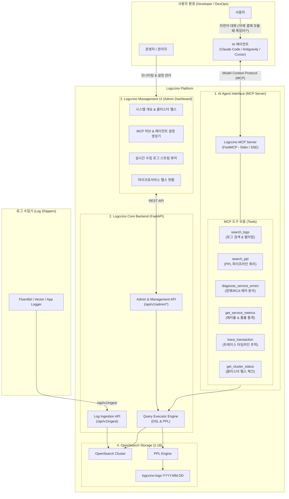

# Logccino Architecture Overview

Logccino는 사람이 직접 복잡한 대시보드를 다루지 않고, **사용자가 사용하는 AI 에이전트(Claude, Google Antigravity, Cursor 등)가 Model Context Protocol (MCP)을 통해 OpenSearch 로그를 직접 탐색·진단할 수 있도록 지원하는 AI Agent-Native 로그 인텔리전스 백엔드 및 관리 플랫폼**입니다.

---

## 🏛️ 시스템 아키텍처 다이어그램

---

## 🚀 에이전트 중심 인터페이스 동작 흐름 (Agent-Centric Workflow)

1. **사용자의 자연어 요청**:
   - 사용자가 Claude, Antigravity, Cursor 등 본인이 사용하는 AI 에이전트에게 질문합니다.
   - *"지금 결제 서비스에서 500 에러 급증한 원인이랑 영향받은 트레이스 추적해줘."*
2. **에이전트의 Logccino MCP 도구 자율 호출**:
   - 에이전트는 제공된 MCP Tool 중 가장 적합한 도구를 판단하여 호출합니다:
     - 1) `diagnose_service_errors(service='payment-gateway', time_window='1h')`: 결제 서비스의 최근 에러 및 스택트레이스 수집
     - 2) `trace_transaction(trace_id='...')`: 문제된 트랜잭션의 전 구간 타임라인 조회
     - 3) `get_service_metrics(time_window='1h')`: 전체 서비스 에러율 메트릭 확인
3. **Logccino의 데이터 가공 및 응답**:
   - OpenSearch로부터 대량의 비정형 로그를 정제하여, AI 에이전트가 읽기 최적화된 구조화된 JSON 데이터로 즉시 반환합니다.
4. **에이전트의 종합 보고**:
   - AI 에이전트(Claude/Antigravity)의 강력한 추론 능력을 바탕으로 사용자에게 원인 분석, 근거 로그, 해결책을 답변합니다.

---

## 🎛️ 관리 UI (Management UI)의 역할

사용자가 직접 로그 검색 쿼리를 짜지 않는 대신, **운영자는 관리 UI를 통해 시스템의 상태를 관리**합니다:
- **클러스터 및 인덱스 헬스**: OpenSearch의 상태(Green/Yellow/Red), 총 도큐먼트 수, 수집량 모니터링
- **MCP 에이전트 허브**:
  - Claude Desktop (`claude_desktop_config.json`), Antigravity CLI, Cursor용 연결 설정 JSON 원클릭 복사
  - 등록된 MCP 도구 파라미터 및 호출 상태 확인
- **실시간 로그 스트림 뷰어**: 수집 파이프라인으로 들어오는 로그를 실시간 테이블 및 JSON으로 확인
- **마이크로서비스 현황**: 각 서비스별 최근 로그 수집 시점 및 24시간 에러 발생률 점검
