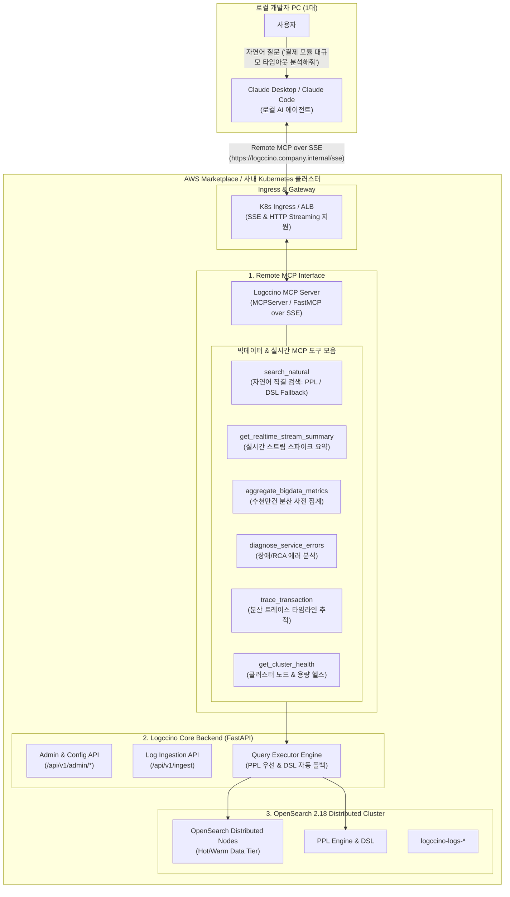

# Logccino Architecture Overview

Logccino는 로컬 1대의 PC에서 동작하는 Claude 같은 AI 에이전트가 단독으로 처리할 수 없는 **대용량(TB) 데이터 및 초고속 실시간 스트림 데이터를 AWS 마켓플레이스 또는 사내 Kubernetes(k8s) 분산 클러스터에서 전담 집계·다운샘플링하여 원격 MCP(SSE)를 통해 Claude에게 전달하는 Agent-Native 빅데이터 인텔리전스 백엔드**입니다.

---

## 🏛️ 시스템 아키텍처 다이어그램

---

## 🚀 대용량 & 실시간 데이터 처리 흐름 (Big Data & Real-Time Workflow)

1. **로컬 PC의 한계 극복**:
   - 로컬 Claude Desktop은 수 테라바이트 로그를 다운로드할 필요가 없습니다.
   - 자연어 질문을 원격 MCP를 통해 Logccino 백엔드로 전송합니다.
2. **분산 클러스터에서의 고속 병렬 연산**:
   - **PPL 지원 시**: OpenSearch PPL 엔진을 통해 파이프라인 집계 쿼리를 초고속 병렬 실행합니다.
   - **PPL 미지원 시**: OpenSearch 기본 Query DSL(bool, filter, terms aggregation, date_histogram)로 자동 전환하여 안전하게 실행합니다.
3. **지능형 다운샘플링 & 컨텍스트 보호**:
   - 수백만 건의 원시 로그를 Claude에게 그대로 보내지 않고, 시계열 트렌드, 이상치 비율, 대표 스택트레이스 샘플로 서버사이드에서 압축하여 전달합니다.
   - Claude는 컨텍스트 윈도우 한계에 걸리지 않고 초정밀 분석 리포트를 생성할 수 있습니다.
4. **엔터프라이즈 배포 간소화**:
   - AWS Marketplace AMI 또는 사내 Kubernetes의 Helm / `kubectl apply -f deploy/k8s/logccino-all-in-one.yaml` 한 방으로 클러스터와 원격 MCP가 즉시 준비됩니다.
