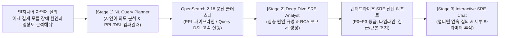

# 🏛️ Logccino Enterprise 자연어 로그 분석 & SRE 프롬프트 엔지니어링 가이드

Logccino Enterprise는 복잡한 검색 쿼리 언어(SPL, DSL)나 파편화된 대시보드 조작 없이, **"SRE 및 엔지니어가 평소 대화하듯 자연어로 질문하고, AI 엔진이 분산 빅데이터 로그를 직접 분석하여 정확한 근본 원인과 실질적 조치 방안을 제시하는 엔터프라이즈 자율형 관제 시스템"**을 구축합니다.

이 문서는 Logccino Enterprise 내부의 **3단계 엔터프라이즈 AI 프롬프트 파이프라인 구조**, **SRE 장애 등급(P0~P3) 판정 기준**, 그리고 **Kibana를 대체하는 자체 엔터프라이즈 웹 대시보드 구축 명세**를 정의합니다.

---

## 1. 엔터프라이즈 3단계 AI 로그 인텔리전스 파이프라인



---

### 1.1. [Stage 1] NL Query Planner (자연어 질의 최적화 컴파일러)
- **모듈 경로**: [nl_to_query.py](file:///home/sst96/Workspace/logccino/core/ai/prompts/nl_to_query.py)
- **임무**: 사용자의 모호한 자연어 표현에서 검색 의도(Intent), 대상 마이크로서비스, 로그 심각도(Level), 상대 시간 윈도우, 필터 조건을 정밀 추출하고, 분산 OpenSearch 클러스터에 최적화된 **PPL(Piped Processing Language) 쿼리** 및 **네이티브 Query DSL**을 동시 생성합니다.
- **엔터프라이즈 질의 의도(Intent) 분류**:
  - `ERROR_DIAGNOSIS`: 장애 및 예외 패턴 분석
  - `TREND_ANALYSIS`: 서비스별 에러율 및 로그 볼륨 시계열 추세 분석
  - `EVENT_LOOKUP`: 특정 분산 트레이스 ID(`trace_id`) 또는 트랜잭션 전 구간 추적
  - `ANOMALY_SEARCH`: 평소 대비 급증한 이상 징후 및 성능 저하(Latency Spike) 탐지

---

### 1.2. [Stage 2] Deep-Dive SRE Incident Analyst (심층 원인 진단 전문가)
- **모듈 경로**: [natural_log_analyst.py](file:///home/sst96/Workspace/logccino/core/ai/prompts/natural_log_analyst.py)
- **임무**: OpenSearch에서 수집된 실제 로그 샘플, 예외 스택트레이스, 타임스탬프를 주입받아, Tier-1 엔터프라이즈 SRE 관점의 **정밀 근본 원인 분석(RCA) 보고서**를 도출합니다.
- **보고서 표준 출력 규격 (5단계 표준 포맷)**:
  1. 📌 **핵심 요약 (Executive Summary)**
     - 결론 요약 (2~3문장)
     - 장애 심각도 등급: **`[CRITICAL P0]`** / **`[HIGH P1]`** / **`[MEDIUM P2]`** / **`[LOW P3]`**
  2. 🔬 **상세 분석 및 근본 원인 규명 (Root Cause & Diagnostics)**
     - 장애 현상 및 메커니즘 (코드 버그, DB 락, 커넥션 풀 고갈, 외부 PG사 타임아웃 등)
     - 실제 근거 로그 및 에러 스택트레이스 직접 인용 (인용 시 마스킹 준수)
  3. ⏱️ **장애 전파 타임라인 및 영향도 (Timeline & Blast Radius)**
     - 최초 발생 시점부터 전파 경로 (예: `auth-service` 지연 ➡️ `payment-service` 타임아웃 ➡️ `api-gateway` 504 반환)
     - 영향받은 서비스(`service`), 호스트 인스턴스, 실패 트랜잭션 수
  4. 🛠️ **실행 가능한 조치 방안 (Actionable Remediation)**
     - 🚨 **긴급 조치 (Immediate Mitigation)**: 즉각적인 트래픽 우회, 서킷 브레이커 트립, 파라미터 임시 증설 등 MTTR 최소화 조치
     - 🔧 **근본 조치 (Permanent Architectural Solution)**: 커넥션 풀 리사이징, 재시도 백오프 알고리즘 도입, 데드락 방지 쿼리 개선 등
  5. 💡 **추천 후속 조사 질문 (Suggested Next Investigation Steps)**
     - 엔지니어가 추가로 확인해야 할 연관 지표 및 후속 자연어 질문 2~3개 추천

---

### 1.3. [Stage 3] Interactive SRE Chat Engine (대화형 후속 분석)
- **모듈 경로**: [chat_analyst.py](file:///home/sst96/Workspace/logccino/core/ai/prompts/chat_analyst.py)
- **임무**: 1차 분석 이후 엔지니어가 연속해서 제기하는 세부 질문(예: *"그때 DB 커넥션 풀 설정값은 몇이었어?"*, *"500 에러를 겪은 주문 ID 및 사용자 목록 추출해줘"*, *"PG사 타임아웃 직전 응답 시간 추이는 어땠어?"*)에 대해, 이전 대화 맥락과 로그 데이터를 결합하여 일관되고 정확한 기술적 답변을 제공합니다.

---

## 2. 엔터프라이즈 웹 대시보드 명세 (Kibana 대체용)

기존 Kibana(5601 포트)는 복잡한 인덱스 패턴 설정과 시각화 빌더로 인해 일반 개발자 및 운영자의 진입 장벽이 높습니다. Logccino는 **별도의 Kibana 없이 FastAPI 백엔드 내장형 웹 대시보드([/dashboard](http://localhost:8000/dashboard))** 및 **Next.js 14 프론트엔드([frontend/](file:///home/sst96/Workspace/logccino/frontend))**를 제공합니다.

### 2.1. 엔터프라이즈 UI 레이아웃 구조

```
+-----------------------------------------------------------------------------------------------+
|  Logccino Enterprise  [OPERATIONAL]  OpenSearch: Healthy (2.18.0)  MCP SSE: /sse  API Docs  |
+-----------------------------------------------------------------------------------------------+
| [KPI 1: 전사 가용성 SLO]   [KPI 2: 24H 수집 볼륨]   [KPI 3: 이상 감지 서비스]   [KPI 4: AI SRE 모델]   |
| 99.70% (목표 99.9%)       26,203 docs (18.2 eps)   1 주의, 1 경고 (알림/결제)   gpt-6-luna (Active)   |
+---------------------------------------------------------------+-------------------------------+
| [좌측 7컬럼]                                                  | [우측 5컬럼]                   |
| 🤖 Autonomous SRE Incident Console (대화형 분석 콘솔)          | 📊 Enterprise Telemetry & Hub |
|                                                               |                               |
| - 실시간 자연어 질문 입력창 ("결제 타임아웃 원인 분석해줘")     | [탭 1: 근거 로그 & 분산 트레이스]|
| - 원클릭 엔터프라이즈 프롬프트 프리셋 (P1 Incident, SLA, RCA)  |   - 레벨별 색상 배지 (P0~P3)  |
| - AI 마크다운 진단 보고서 렌더링 (원인, 타임라인, 조치 방안)    |   - 클릭 시 JSON 원본 팝업     |
| - 클릭 가능한 추천 후속 질문 칩(Chips)                        | [탭 2: 시계열 & 이상치 차트]  |
|                                                               |   - 서비스별 볼륨/에러 막대   |
|                                                               |   - 로그 레벨 분포 파이 차트  |
|                                                               | [탭 3: AI 에이전트 연동 허브]  |
|                                                               |   - Claude Desktop 원클릭 복사|
+---------------------------------------------------------------+-------------------------------+
```

---

## 3. 엔터프라이즈 장애 대응 시나리오 프롬프트 예시

### 3.1. [P1 긴급 장애 대응 프롬프트]
> **질문**: *"현재 payment-service에서 결제 실패가 발생하고 있습니다. 최근 1시간 동안의 에러 로그와 스택트레이스를 분석하고, 원인과 긴급 조치 방안을 보고서로 작성해주세요."*
- **MCP 도구 호출**: `diagnose_service_errors(service="payment-service", time_window="1h", limit=10)`
- **결과 도출**: Stripe PG사 5000ms 타임아웃 감지, 영향받은 트레이스 ID 추적, 프록시 IP 확인 및 PG사 페일오버 권고

### 3.2. [전사 서비스 SLA/SLO 안정성 감사 프롬프트]
> **질문**: *"전사 마이크로서비스의 24시간 로그 볼륨 및 에러율을 집계하여, SLA 임계치를 초과한 서비스와 상태(정상/주의/경고)를 표로 요약해주세요."*
- **MCP 도구 호출**: `aggregate_bigdata_metrics(time_window="24h", group_by="service")`
- **결과 도출**:
  - `notification-service`: 2.87% (경고 🔴 - 일일 SMS 쿼터 초과)
  - `payment-service`: 0.31% (주의 ⚠️ - 간헐적 소켓 타임아웃)
  - `auth-service`: 0.02% (정상 ✅ - 안정적 운영 중)
